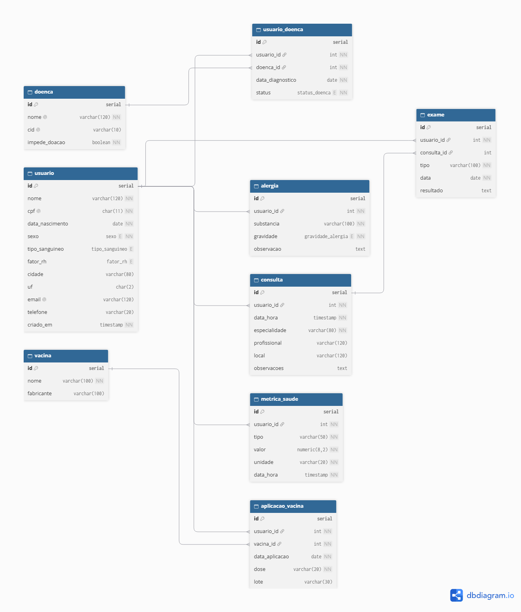
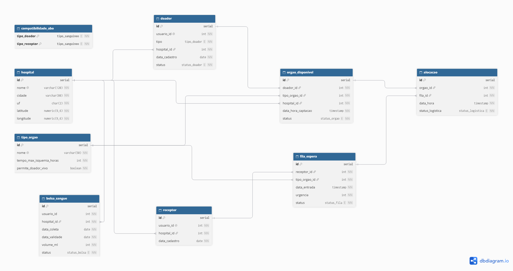

# Gestão Hospitalar

Dois sistemas em PostgreSQL, cada um com o seu banco. O **Diário de Saúde Pessoal** guarda os dados de cada pessoa: cadastro, tipagem sanguínea, alergias, doenças, consultas, exames, vacinas e métricas. A **Central Hospitalar de Transplantes** cuida de doadores, receptores, fila de espera, órgãos, alocações e banco de sangue. A Central se integra ao Diário apenas pelo `usuario_id`: ela não copia tipagem nem dados clínicos, e sempre os consulta no Diário.

## Início rápido

Requisitos: Python 3.10 ou superior e PostgreSQL 14 ou superior.

Os comandos para Windows usam o PowerShell. Logo abaixo de cada passo estão os equivalentes para Linux e macOS. Rode tudo na pasta raiz do projeto.

### 1. Instalar o PostgreSQL

Windows:

```powershell
winget install PostgreSQL.PostgreSQL.16 --interactive
```

O `--interactive` abre o instalador, onde você escolhe a senha do usuário `postgres`. Guarde essa senha. Se você instalou sem o `--interactive` e não sabe a senha, teste `postgres`.

Confira se o serviço está rodando (o status deve ser `Running`):

```powershell
Get-Service postgresql*
```

Se estiver parado: `Start-Service postgresql-x64-16` (em um PowerShell aberto como administrador).

Linux (Debian/Ubuntu):

```bash
sudo apt install postgresql
sudo systemctl status postgresql
sudo -u postgres psql -c "ALTER USER postgres PASSWORD 'sua_senha';"
```

macOS (Homebrew):

```bash
brew install postgresql@16
brew services start postgresql@16
psql postgres -c "CREATE ROLE postgres WITH LOGIN SUPERUSER PASSWORD 'sua_senha';"
```

No macOS, se o papel `postgres` já existir, troque `CREATE ROLE` por `ALTER ROLE`.

### 2. Criar e ativar o ambiente virtual

Windows:

```powershell
python -m venv .venv
.venv\Scripts\Activate.ps1
```

Se o PowerShell bloquear o script de ativação, rode uma vez `Set-ExecutionPolicy -Scope CurrentUser RemoteSigned` e tente de novo. No Prompt de Comando (cmd), use `.venv\Scripts\activate.bat`.

Linux e macOS:

```bash
python3 -m venv .venv
source .venv/bin/activate
```

**Atenção:** a venv precisa ser ativada em todo terminal novo. Com ela ativa, o prompt começa com `(.venv)`.

### 3. Instalar as dependências

```bash
pip install -r requirements.txt
```

### 4. Configurar o `.env`

Windows:

```powershell
copy .env.exemplo .env
```

Linux e macOS:

```bash
cp .env.exemplo .env
```

Abra o `.env` e troque `sua_senha_aqui` pela senha do usuário `postgres` nas **três** linhas:

```text
PGPASSWORD=...
DIARIO_PGPASSWORD=...
CENTRAL_PGPASSWORD=...
```

Não mude os outros valores. Eles já apontam para o PostgreSQL local (`127.0.0.1`).

### 5. Criar e povoar os bancos

```bash
python criar_bancos.py --sim
```

Isso cria `diario_saude` e `central_transplantes` com dados fictícios. O `--sim` pula a pergunta de confirmação. Se os bancos já existirem, eles são apagados e recriados.

Resultado esperado: as linhas `✔ sql/...` dos quatro scripts e `>> Bancos criados e povoados com sucesso.`

### 6. Verificar a conexão

```bash
python main.py
```

Escolha a opção `5` (Verificar conexao com os bancos). Resultado esperado:

```text
  Diario de Saude            OK (9 tabelas)
  Central de Transplantes    OK (9 tabelas)
  Bancos: diario_saude e central_transplantes
  [OK] Tudo pronto para uso.
```

## Como usar

As três interfaces usam os mesmos serviços do backend, então o que você faz em uma aparece nas outras.

- **Menus de terminal:** `python main.py`, opção `1` para o Diário e opção `2` para a Central. Também abrem direto com `python -m terminal.diario` e `python -m terminal.central`.
- **Interface gráfica (Tkinter):** janela com abas para os dois sistemas. Abre com `python gui.py` ou pela opção `3` do `main.py`.
- **Front web:** aplicação no navegador, servida pela API HTTP do projeto. Abre com `python API\api.py` (no Linux e no macOS, `python API/api.py`) ou pela opção `4` do `main.py`. Depois acesse <http://localhost:8000>. Para outra porta: `python API\api.py 8080`. Encerre com `Ctrl+C`.

```bash
python main.py
python gui.py
python API/api.py
```

## Roteiro de teste (5 a 10 minutos)

Use os menus de terminal. Comece com os dados iniciais (passo 5 do Início rápido). Em cada menu, digite o número da opção e tecle ENTER. A opção `0` volta ao menu anterior. Depois de cada ação, tecle ENTER para continuar.

```bash
python main.py
```

**a) Verificar a conexão.** No menu inicial, opção `5`.

Esperado: os dois bancos com `OK (9 tabelas)` e `[OK] Tudo pronto para uso.`

**b) Diário: cadastrar um usuário com tipagem.** Menu inicial `1` (Diário), depois `1` (Usuarios) e `3` (Cadastrar usuario). Preencha:

| Campo | Valor |
| --- | --- |
| Nome completo | Ana Banca Teste |
| CPF | 52998224725 (fictício, mas válido) |
| Data de nascimento | 1990-05-10 |
| Sexo | feminino |
| Cidade / UF | Fortaleza / CE |
| E-mail / Telefone | deixe em branco (ENTER) |
| Informar o tipo sanguineo agora? | S |
| Tipo sanguineo / Fator RH | A / positivo |

Esperado: `[OK] Usuario cadastrado com o ID 21.` Com os dados iniciais o ID é 21. Anote o ID.

**c) Diário: prontuário e linha do tempo.** Ainda em Usuarios, opção `6` (Prontuario completo) e o ID anotado. Depois, opção `7` (Linha do tempo) e o mesmo ID.

Esperado: o prontuário mostra CPF, nascimento com a idade, sexo, `Tipo sanguineo.: A+` e as seções de diagnósticos, consultas, exames, vacinas e métricas vazias. A linha do tempo mostra `Nenhum evento registrado.`, pois o usuário é novo. Para ver um prontuário preenchido, repita com o ID `10` (12 eventos na linha do tempo).

Tecle `0` duas vezes para voltar ao menu inicial.

**d) Central: cadastrar um doador.** Menu inicial `2` (Central), depois `1` (Doadores) e `2` (Cadastrar doador). A lista mostra os usuários do Diário. Escolha o ID `1` (Ana Beatriz Lima, que ainda não é doadora), tipo `vivo` e hospital `1`.

Esperado: `[OK] Doador 4 cadastrado (apto).` O status `apto` foi calculado com as doenças registradas no Diário. Tecle `0` para voltar.

**e) Central: cadastrar o receptor e incluir na fila.** Opção `2` (Receptores e fila de espera), depois `4` (Cadastrar receptor). Escolha o ID do passo b e o hospital `1` (Hospital Central de Fortaleza). Em `Incluir na fila de espera agora?`, responda `S`. Escolha o tipo de órgão `1` (Rim) e a urgência `5`.

Esperado: `[OK] Receptor cadastrado com o ID 14.` e `[OK] Receptor incluido na fila (ID 14).` Tecle `0` para voltar.

**f) Central: selecionar receptores para um rim.** Opção `4` (Compatibilidade e alocacao), depois `1` (Selecionar receptores para um orgao). Escolha o órgão `3` (Rim, doador A+). Em `Alocar o orgao agora`, responda `N`, para não alterar os dados.

Esperado: a oferta `Rim de Carlos Eduardo Menezes (A)`. Em "Candidatos elegiveis", Ana Banca Teste aparece na posição 1, com sangue `A+`, urgência 5, `mesmo hospital` e isogrupo `sim`. Esse `A+` não está na Central: veio do Diário. Em "Descartados e o motivo" aparecem, por exemplo, `Incompatível ABO (A → B)`.

Tecle `0` duas vezes para voltar ao menu inicial.

**g) Prova da integração.** Menu inicial `1` (Diário), depois `1` (Usuarios) e `5` (Registrar tipagem sanguinea). Escolha o ID do passo b e informe tipo `O` e fator `negativo`. Volte ao menu inicial e repita o passo f: `2`, `4`, `1`, órgão `3` e `N`.

Esperado: Ana Banca Teste sai da lista de elegíveis e aparece em "Descartados e o motivo" com sangue `O-` e `Incompatível ABO (A → O)`. Nada foi alterado na Central. A seleção leu a nova tipagem direto do Diário, pelo `usuario_id`.

**h) Voltar aos dados iniciais.** Saia com `0` até fechar o programa e rode:

```bash
python criar_bancos.py --sim
```

## Problemas comuns

### `ModuleNotFoundError: No module named 'psycopg2'`

A venv não está ativada neste terminal. Ative de novo (passo 2 do Início rápido) e confira se o prompt começa com `(.venv)`. Se o erro continuar, rode `pip install -r requirements.txt` com a venv ativa.

### `Não foi possível conectar ao banco ...`

Há três causas comuns:

- O serviço do PostgreSQL está parado. Confira com `Get-Service postgresql*` (Windows) ou `sudo systemctl status postgresql` (Linux).
- A senha no `.env` está errada. Ela precisa ser a mesma nas três linhas `PASSWORD`.
- Os bancos ainda não foram criados. Se o detalhe do erro disser `does not exist`, rode `python criar_bancos.py --sim`.

### Órgãos aparecem como inviáveis ou com o tempo de isquemia esgotado

Mensagens como `Inviável: transporte de ... h > ... h restantes` ou `excedeu o tempo máximo de isquemia` aparecem quando os dados envelhecem. Os órgãos fictícios são captados na hora do povoamento, e alguns duram pouco: coração 4 h, fígado 12 h, rim 36 h. Rode `python criar_bancos.py --sim` de novo para renovar os horários.

### A interface gráfica não abre (Tkinter ausente)

O `main.py` explica o problema e sugere o comando de instalação. No Windows, o Tkinter vem com o instalador do python.org. No Linux, instale `sudo apt install python3-tk`. No macOS com Homebrew, instale `brew install python-tk`. Os menus de terminal e o front web não dependem do Tkinter.

## Modelo de dados

Diário de Saúde ([diario_saude.dbml](docs/der/diario_saude.dbml)):



Central de Transplantes ([central_transplantes.dbml](docs/der/central_transplantes.dbml)):



A descrição das relações está em [docs/DER.md](docs/DER.md). Os scripts de criação são a referência completa: [sql/diario/01_criacao.sql](sql/diario/01_criacao.sql) e [sql/central/01_criacao.sql](sql/central/01_criacao.sql).

## Integração e regras de compatibilidade

A Central armazena o `usuario_id` e consulta os dados clínicos no Diário por meio de um gateway somente de leitura. Não há cópia local de tipagem ou de dados clínicos na Central. Por isso, divergências entre cópias de sangue não se aplicam. As restrições clínicas são consultadas na triagem e na seleção de doadores.

A seleção de órgãos considera compatibilidade ABO, urgência, semelhança do tipo sanguíneo (isogrupo), tempo em fila, distância e tempo de isquemia. O fator Rh não entra na seleção de órgãos. Na transfusão de sangue, vale ABO e também o fator Rh.

O menu de compatibilidade mostra os candidatos elegíveis na ordem de alocação. Logo abaixo, mostra os descartados com o motivo devolvido pelo backend, por exemplo `Incompatível ABO (A → B)` ou `Inviável: transporte de 9.0 h > 2.9 h restantes`.

## Para desenvolvedores

### Estrutura de pastas

```text
backend/          Serviços, modelos, validação, integração e conexão PostgreSQL
API/              API HTTP do front web
web/              Aplicação web (HTML, CSS e JavaScript)
terminal/         Menus de terminal (ui.py, enums.py, diario.py, central.py)
gui.py            Interface gráfica (abas em backend/*/interface.py)
main.py           Menu inicial: escolhe a interface
sql/              Esquemas (01), dados de exemplo (02) e operações SQL (03)
docs/             Modelo de dados (DER.md) e arquivos do DER em docs/der/
tests/            Testes automatizados do backend
criar_bancos.py   Criação e povoamento dos bancos
demo_backend.py   Demonstração do backend do início ao fim
```

Nenhuma interface escreve SQL. Tudo passa por `DiarioService`, `CentralService` e `DiarioGateway`. As opções de sexo, tipo sanguíneo, fator RH, gravidade, status de doença e tipo de doador vêm dos `ENUM` do PostgreSQL (`pg_enum`). Um valor novo no banco aparece sozinho nos menus.

### Variáveis de ambiente

O `.env.exemplo` lista todas as variáveis lidas por `backend/conexao.py`:

- `DIARIO_DB` e `CENTRAL_DB`: nomes dos bancos.
- `PGHOST`, `PGPORT`, `PGUSER`, `PGPASSWORD` e `PGSSLMODE`, sem prefixo.
- As mesmas cinco com prefixo `DIARIO_` e `CENTRAL_`.

Na conexão de cada sistema, a variável com prefixo tem prioridade. Se ela faltar, vale a sem prefixo. Variáveis definidas no ambiente do sistema operacional têm prioridade sobre o `.env`.

> **Aviso:** `criar_bancos.py` e `demo_backend.py` **apagam e recriam** os bancos `DIARIO_DB` e `CENTRAL_DB` no servidor das variáveis **sem prefixo** (`PGHOST`, `PGUSER`, `PGPASSWORD`). O `demo_backend.py` faz isso sem pedir confirmação. Nunca rode esses scripts com um `.env` que aponte para um banco compartilhado ou na nuvem. Nunca use `postgres` como nome de banco.

### Demonstração

```bash
python demo_backend.py
```

Recria os bancos e executa o fluxo completo: cadastros, seleção, alocação, logística e banco de sangue. Com `--sem-recriar`, usa os dados atuais, que precisam estar no estado inicial. Depois do demo, rode `python criar_bancos.py --sim` para voltar aos dados iniciais.

### Testes automatizados

```bash
python -m pytest -q
```

Resultado esperado: `41 passed`. Os testes usam bancos separados, `diario_saude_teste` e `central_transplantes_teste`, recriados a cada teste com as credenciais sem prefixo do `.env`. Os bancos principais não são tocados.

### Operações SQL de exemplo

Os scripts `03_operacoes.sql` mostram consultas, funções e alterações em SQL puro. As alterações ficam dentro de uma transação desfeita com `ROLLBACK` no final. Os scripts esperam os dados iniciais, então rode `criar_bancos.py --sim` antes se tiver usado o demo ou o roteiro de teste.

Windows (o `psql` não fica no PATH por padrão):

```powershell
& "C:\Program Files\PostgreSQL\16\bin\psql.exe" -h 127.0.0.1 -U postgres -d diario_saude -f sql\diario\03_operacoes.sql
& "C:\Program Files\PostgreSQL\16\bin\psql.exe" -h 127.0.0.1 -U postgres -d central_transplantes -f sql\central\03_operacoes.sql
```

Linux e macOS:

```bash
psql -h 127.0.0.1 -U postgres -d diario_saude -f sql/diario/03_operacoes.sql
psql -h 127.0.0.1 -U postgres -d central_transplantes -f sql/central/03_operacoes.sql
```
