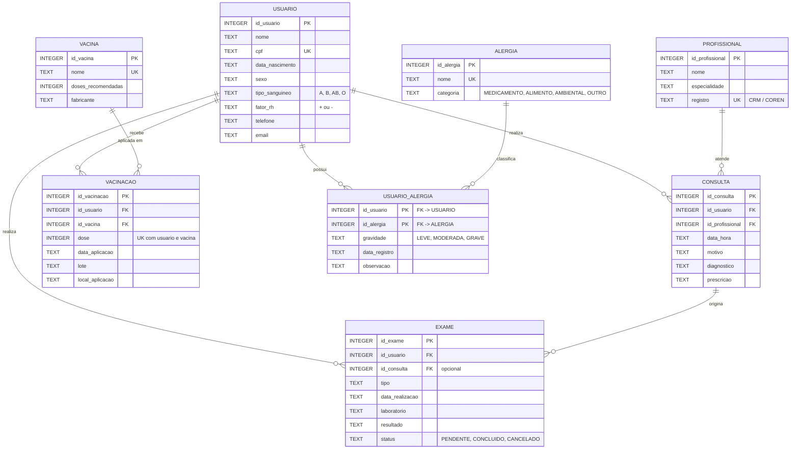
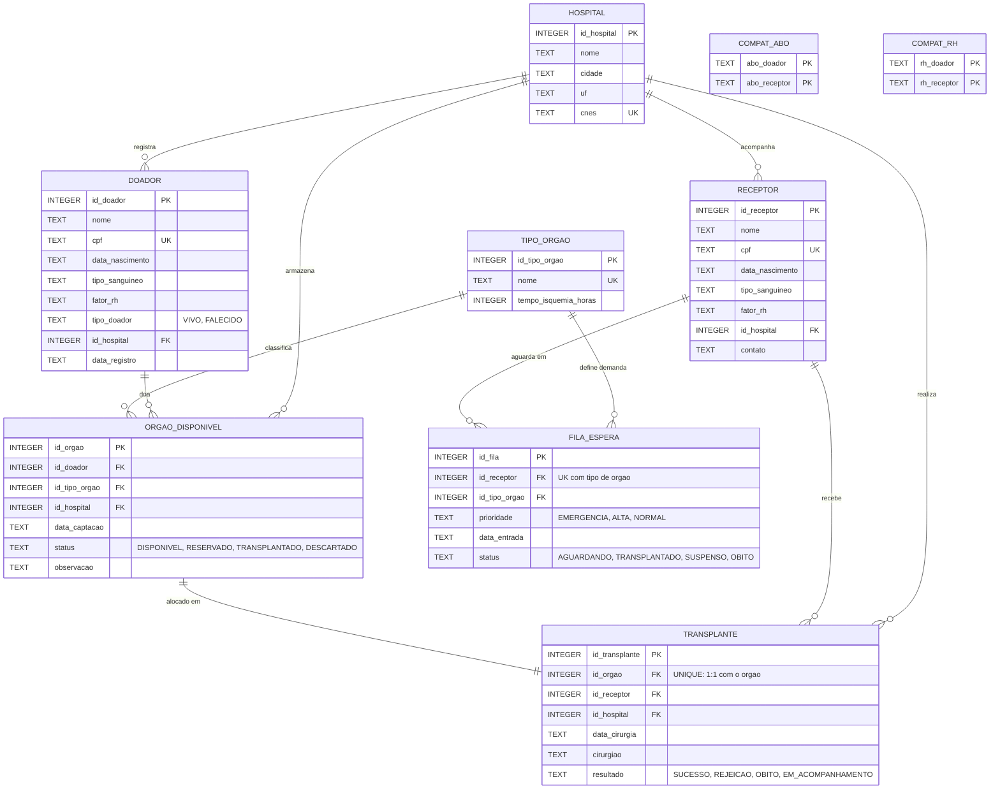

# Modelagem dos Bancos de Dados (DER / MER)

SGBD utilizado: **SQLite 3**.
Scripts de criacao: `DiarioPessoal/bdDiarioPessoal.sql` e
`CentralHospitalar/bdCentralHospitalar.sql`.

Convencoes dos diagramas: `PK` chave primaria, `FK` chave estrangeira,
`UK` chave unica. A notacao de cardinalidade segue o padrao "pe de galinha"
(`||--o{` = um para muitos, `}o--o{` = muitos para muitos).

---

## 1. Diario de Saude Pessoal

### Entidades e cardinalidades

| Relacionamento | Cardinalidade | Leitura |
|---|---|---|
| USUARIO - CONSULTA | 1:N | um usuario tem varias consultas; cada consulta pertence a um usuario |
| PROFISSIONAL - CONSULTA | 1:N | um profissional realiza varias consultas |
| USUARIO - EXAME | 1:N | um usuario realiza varios exames |
| CONSULTA - EXAME | 1:N (opcional) | um exame pode ter se originado de uma consulta (FK aceita NULL) |
| USUARIO - VACINACAO | 1:N | um usuario recebe varias doses |
| VACINA - VACINACAO | 1:N | uma vacina e aplicada em varias doses/usuarios |
| USUARIO - ALERGIA | N:N | resolvido pela tabela associativa USUARIO_ALERGIA |



### Decisoes de modelagem

- **Tipo sanguineo e fator RH separados** (`tipo_sanguineo` + `fator_rh`), com
  `CHECK` em cada um. A exibicao "O-" e feita por concatenacao nas consultas.
- **Alergias em catalogo + tabela associativa**: evita repetir o nome da
  alergia em cada usuario e permite que a *gravidade* seja um atributo do
  relacionamento, nao da alergia.
- **Exame com FK opcional para consulta**: exames podem ser avulsos
  (`ON DELETE SET NULL` preserva o exame se a consulta for removida).
- **VACINACAO com `UNIQUE (id_usuario, id_vacina, dose)`**: impede registrar a
  mesma dose duas vezes e permite calcular doses faltantes comparando com
  `vacina.doses_recomendadas`.

---

## 2. Central Hospitalar de Transplantes

### Entidades e cardinalidades

| Relacionamento | Cardinalidade | Leitura |
|---|---|---|
| HOSPITAL - DOADOR / RECEPTOR | 1:N | cada pessoa esta vinculada a um hospital |
| DOADOR - ORGAO_DISPONIVEL | 1:N | um doador pode doar varios orgaos |
| TIPO_ORGAO - ORGAO_DISPONIVEL | 1:N | classifica o orgao captado |
| RECEPTOR - FILA_ESPERA | 1:N | um receptor pode aguardar mais de um tipo de orgao |
| TIPO_ORGAO - FILA_ESPERA | 1:N | cada posicao na fila e para um tipo de orgao |
| ORGAO_DISPONIVEL - TRANSPLANTE | 1:1 | um orgao gera no maximo um transplante (`UNIQUE`) |
| RECEPTOR - TRANSPLANTE | 1:N | um receptor pode receber mais de um transplante ao longo do tempo |



### Compatibilidade como dado, nao como codigo

As regras de compatibilidade sanguinea ficam em duas tabelas de dominio:

| compat_abo | |
|---|---|
| O | O, A, B, AB |
| A | A, AB |
| B | B, AB |
| AB | AB |

| compat_rh | |
|---|---|
| - | -, + |
| + | + |

A view `vw_compatibilidade` cruza orgao disponivel x fila de espera usando
essas tabelas, de modo que a compatibilidade e resolvida em SQL puro:

```sql
JOIN compat_abo ca ON ca.abo_doador = d.tipo_sanguineo
                  AND ca.abo_receptor = r.tipo_sanguineo
JOIN compat_rh  cr ON cr.rh_doador  = d.fator_rh
                  AND cr.rh_receptor = r.fator_rh
WHERE o.status = 'DISPONIVEL' AND f.status = 'AGUARDANDO'
```

A ordem de alocacao aplicada nas consultas e: **prioridade**
(EMERGENCIA > ALTA > NORMAL) e, em seguida, **maior tempo de espera**.

### Decisoes de modelagem

- **TIPO_ORGAO como entidade** (e nao um texto livre em ORGAO_DISPONIVEL):
  garante que fila e orgao falem do mesmo orgao e guarda o tempo de isquemia,
  usado para destacar orgaos fora do prazo.
- **ORGAO_DISPONIVEL com status**: o ciclo de vida do orgao
  (DISPONIVEL -> RESERVADO -> TRANSPLANTADO / DESCARTADO) fica em um unico
  registro, sem precisar apagar dados.
- **FILA_ESPERA com `UNIQUE (id_receptor, id_tipo_orgao)`**: o receptor nao
  entra duas vezes na mesma fila, mas pode aguardar orgaos diferentes.
- **TRANSPLANTE com `UNIQUE (id_orgao)`**: impede alocar o mesmo orgao duas
  vezes. A efetivacao do transplante ocorre em uma transacao que insere o
  transplante e atualiza o status do orgao e da fila.
